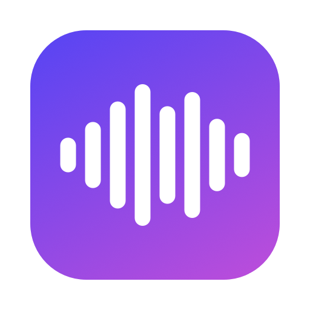

<p align="center">
  
</p>

<h1 align="center">Murmur</h1>

<p align="center">
  Private, on-device voice dictation for the Mac menu bar and the Windows tray.<br>
  Hold <kbd>Right ⌥</kbd> (Mac) or <kbd>Right Alt</kbd> (Windows), talk, let go, and your words are typed wherever your cursor is.
</p>

---

Murmur is a small, native dictation app in the spirit of Aqua Voice, Wispr Flow and Google AI Edge Eloquent.
Everything runs locally with the speech engine that ships with your operating system (Apple Speech on macOS,
the in-box Windows speech recognizer on Windows), so there is no account, no API key and nothing to sign up for.

The Mac app is the original; the [Windows app](#windows) is a port with the same hold-to-talk behaviour.

## Features

- **Push-to-talk on one key.** Hold <kbd>Right ⌥</kbd> to talk and release to insert the text. Tap it instead
  for hands-free mode, and tap again to stop.
- **Turns your music down while you talk.** Spotify, Music, YouTube and anything else making sound is lowered
  to 30%, lowered to 10%, or muted while you dictate, then faded back up. This works on every output, including
  HDMI and DisplayPort monitors that macOS can't change the volume of.
- **Doesn't clip your words.** The mic starts the instant you press the key and audio is buffered while the speech
  engine gets ready. Recording continues for half a second after you let go.
- **Live indicator.** A small pill at the bottom of the screen shows your voice level while you talk and pulsing
  dots while it transcribes.
- **Optional clean-up.** Removes "um", "uh", stutters and false starts with Apple's on-device language model.
- **Types into any app.** Text is pasted at the cursor and your clipboard is restored afterwards.
- **Still a normal key.** If you use <kbd>Right ⌥</kbd> in a shortcut (like <kbd>⌥E</kbd>), dictation is cancelled.

## Requirements

- macOS 26 (Tahoe) or later
- Apple silicon Mac
- Apple Intelligence turned on, for the optional clean-up only

## Install

1. Download `Murmur-x.y.z.zip` from the [latest release](../../releases/latest), unzip it and move
   `Murmur.app` to `/Applications`.
2. Murmur isn't notarized, so macOS blocks it the first time. Either open **System Settings → Privacy &
   Security** and click **Open Anyway**, or run:

   ```bash
   xattr -dr com.apple.quarantine /Applications/Murmur.app
   ```

3. Open Murmur. A mic icon appears in the menu bar, and macOS asks for these permissions:

   | Permission | Why |
   | --- | --- |
   | Microphone | To hear you while the hotkey is held |
   | Accessibility | To detect <kbd>Right ⌥</kbd> and paste the text into other apps |
   | Audio capture | To turn down other apps' audio while you dictate |

   After granting Accessibility, quit Murmur and open it again.

The first launch downloads Apple's speech model for your language. The menu shows progress.

## Usage

| Action | What happens |
| --- | --- |
| Hold <kbd>Right ⌥</kbd>, talk, release | Text is typed at the cursor |
| Tap <kbd>Right ⌥</kbd>, talk, tap again | Hands-free dictation |
| <kbd>Right ⌥</kbd> + another key | Normal shortcut; dictation is cancelled |

Settings are in the menu bar menu:

- **Music While Dictating:** Off, Lower to 30%, Lower to 10% (the default) or Mute
- **Clean Up Filler Words:** on by default when Apple Intelligence is available

## Build from source

You need the Xcode command line tools with the macOS 26 SDK.

```bash
git clone https://github.com/ltanedo/murmur.git
cd murmur
./build.sh            # builds ./Murmur.app
open Murmur.app
```

Other commands:

- `./build.sh --release` builds `dist/Murmur.app` and `dist/Murmur-<version>.zip`.
- `open Murmur.app --args --demo-overlay` plays the on-screen indicator with a fake voice.
- `swift Scripts/make-icon.swift` regenerates the app icon.

> **Note:** builds are ad-hoc signed, so macOS treats every rebuild as a new app and turns off its
> Accessibility permission. After rebuilding, remove Murmur from **Privacy & Security → Accessibility**,
> add it again and relaunch.

## How it works

| File | Role |
| --- | --- |
| [`HotKey.swift`](Sources/Murmur/HotKey.swift) | Watches <kbd>Right ⌥</kbd> for press, release and use in shortcuts |
| [`Transcriber.swift`](Sources/Murmur/Transcriber.swift) | Captures the mic with `AVAudioEngine`, converts it to 16 kHz mono and streams it to `SpeechAnalyzer` with a `DictationTranscriber`. A session is prepared ahead of time so dictation starts instantly |
| [`AudioDucker.swift`](Sources/Murmur/AudioDucker.swift) | Creates a Core Audio process tap on the apps that are playing sound, mutes them at the source and plays their audio back through a private aggregate device at a lower gain |
| [`Overlay.swift`](Sources/Murmur/Overlay.swift) | The floating, click-through indicator (SwiftUI in a non-activating panel) |
| [`Cleanup.swift`](Sources/Murmur/Cleanup.swift) | Optional filler-word removal with the `FoundationModels` on-device model |
| [`TextInserter.swift`](Sources/Murmur/TextInserter.swift) | Pastes with a synthetic <kbd>⌘V</kbd> and restores the clipboard. Without Accessibility the text is left on the clipboard instead |
| [`AppDelegate.swift`](Sources/Murmur/AppDelegate.swift) | Menu bar item, settings and the dictation state machine |

## Windows editions

[Download Windows GGML](https://github.com/ltanedo/murmur/releases/tag/windows-ggml-v1.0.0.3) ·
[Microsoft offline/cloud edition](https://github.com/ltanedo/murmur/releases/tag/windows-microsoft-v1.0.0.1) ·
[Mac 0.1.0](https://github.com/ltanedo/murmur/releases/tag/v0.1.0)

The default build is the standalone GGML edition. It bundles English Whisper `base.en` Q5_1 (~60 MB)
and runs it on the CPU through Whisper.net / whisper.cpp. Windows AI and Windows cloud speech engines
are excluded from compilation. No model selection, Windows Update model download, account, or network
connection is needed for dictation. Model loading ignores any engine preferences saved by older builds.

Install both `.msix` assets from the release in the same folder, then run:

```powershell
Add-AppxPackage -Path .\Murmur-ggml-signed.msix -DependencyPath .\Microsoft.WindowsAppRuntime.2-experimentalF.msix
```

The release is signed as Lloyd Tanedo using Azure Artifact Signing, with Microsoft timestamps.
The Windows runtime dependency is still required by this port's packaging. Both Windows editions share
one package identity and are alternatives: installing one replaces the other. Switching to a lower
package version requires uninstalling the existing edition first. Both editions now build from the same source tree using the build-time edition setting.

Hold **Right Alt**, speak, then release to transcribe and type. Tap to toggle hands-free mode.
Audio remains in memory; the model remains loaded between recordings. Sessions are limited to five
minutes. Very short or silent captures are discarded; background noise may still cause incorrect text.
Microphone permission is required. Transcripts are logged only if debug logging is explicitly enabled.

### Microsoft offline/cloud edition

Build with `-Edition Microsoft` to include the Windows engines instead of Whisper. This edition defaults
to online dictation; uncheck **Use Online Dictation (restart required)** and restart for Windows AI local
speech. Unsupported Windows AI systems fall back to online recognition with a notification.
Local Windows AI speech requires Windows 11 24H2/build 26100 or later and a model download via Windows
Update. Online speech requires the Windows speech privacy setting, an appropriate language pack, and
organization policy permitting it; audio may be sent to Microsoft. Microphone permission is required.
Neither GGML code nor the bundled model is included in the Microsoft build.

Install `Murmur-microsoft-signed.msix` with the same runtime dependency using `Add-AppxPackage`.
Microsoft live recognition remains unverified on this laptop: its Windows version is below the offline
minimum and its policy disables online recognition. Builds and package generation are checked for both
editions; the Mac application sources are unchanged.

### Build and validation

Use Windows x64 with the .NET 8 SDK (or a newer SDK supporting the .NET 8 target):

```powershell
.\Windows\fetch-model.ps1
.\Windows\build.ps1 -Edition Ggml       # bundled GGML, development certificate
.\Windows\build.ps1 -Edition Microsoft  # Microsoft engines, no model download
# Publicly trusted release, using your Azure CLI login and signing metadata:
.\Windows\release.ps1 -Edition Ggml -Version 1.0.0.3 -OutputName Murmur-ggml-signed -SigningMetadataPath C:\path\metadata.json
.\Windows\release.ps1 -Edition Microsoft -Version 1.0.0.1 -OutputName Murmur-microsoft-signed -SigningMetadataPath C:\path\metadata.json
# Native runtime and failure-path smoke checks:
dotnet run --project Windows/LocalSpeechSmoke -c Release
# Optional real-model check (whisper.cpp samples/jfk.wav, 16 kHz mono PCM16):
dotnet run --project Windows/LocalSpeechSmoke -c Release -- Windows/Murmur/Models/speech-model.bin C:\path\jfk.wav
```

To check that the two publish directories contain only their intended engines and dependencies, run

```powershell
dotnet run --project Windows/EditionSmoke -c Release -- C:\path\ggml-publish C:\path\microsoft-publish
```

`fetch-model.ps1` pins model revision `5359861c739e955e79d9a303bcbc70fb988958b1` and verifies SHA-256
`4baf70dd0d7c4247ba2b81fafd9c01005ac77c2f9ef064e00dcf195d0e2fdd2f`. The binary is bundled in releases,
not committed to Git. The model's MIT license is included in `Notices/Whisper-LICENSE.txt`.

A sample run on an i7-13800H loaded the model in 0.12 s and transcribed an 11 s JFK clip in 0.89 s.
Native CPU loading, missing/invalid models, silence rejection, and signatures were checked. This is a
smoke test, not a microphone accuracy benchmark. The original Mac sources are unchanged.

## Privacy

- Mac audio and text are processed locally by Apple Speech.
- The GGML Windows edition processes audio locally with its bundled Whisper model. It never selects Windows
  online speech or uploads recordings. Audio is kept in memory for the current recording.
- Debug logging is off by default. If enabled, it records transcripts. Mac logging can be enabled with
  `defaults write app.murmur.dictation debugLogging -bool true`; Windows uses `Murmur.exe --debug`.

## Troubleshooting

- **The indicator shows but no text appears.** Accessibility is probably off. Your text is on the clipboard, so
  press <kbd>⌘V</kbd>. Then re-enable Murmur in **Privacy & Security → Accessibility** and relaunch.
- **Music doesn't get quieter.** Check that Murmur is allowed under **Privacy & Security → Screen & System
  Audio Recording** (shown as audio capture).
- **The first word is cut off.** Some USB mics take around 300 ms to start. Pause briefly after pressing the key.
- **Windows: model missing.** Reinstall the bundled GGML edition to restore the model.
- **Windows: nothing happens when holding Right Alt.** Allow microphone access and test in a non-elevated window.

## License

[MIT](LICENSE)
